<section class="cover">
<div class="uni"><strong>Universidade da Beira Interior</strong>Faculdade de Engenharia · Departamento de Informática</div>
<div class="middle">
<div class="kicker">Relatório do trabalho prático</div>
<h1>FixTag</h1>
<div class="tagline">Registo e acompanhamento de avarias em máquinas industriais</div>
<div class="rule"></div>
<div class="brief">Aplicação Android com armazenamento local · Programação de Dispositivos Móveis</div>
</div>
<dl>
<dt>Autor</dt><dd>Hugo Carvalho, a36295</dd>
<dt>Docente</dt><dd>Professor Paulo Fazendeiro</dd>
<dt>Data</dt><dd>8 de novembro de 2026</dd>
<dt>Código</dt><dd>github.com/0xmaiev/FixTag, branch <code>entrega-11-08</code></dd>
</dl>
</section>

[TOC]

## 1. Introdução

Quando uma máquina pesada pára numa pedreira, muitas vezes o operador liga ou envia mensagens soltas à assistência (WhatsApp, e-mail) sem número de série, sem fotos organizadas e sem contexto. O fabricante perde tempo a perceber qual a máquina, a versão e o problema, e não existe histórico estruturado por equipamento. Além disso, as pedreiras têm frequentemente pouca ou nenhuma cobertura.


O FixTag dá a cada máquina um histórico de ocorrências. O operador reporta a avaria no local, com descrição, gravidade, fotos, áudio e localização, mesmo sem rede, e o fabricante acompanha-a até estar resolvida.

Esta entrega continua a de 27/10, que apresentou a variante demo, só com dados locais, e o protocolo experimental sobre persistência local e funcionamento offline. Nessa altura, a aplicação tinha um só cliente e um só fabricante. Agora há vários de cada, e um cliente pode ter máquinas de fabricantes diferentes. A assistência atribui as ocorrências a técnicos, o autor de uma ocorrência pode editá-la, os gestores criam as contas da sua organização e a variante full liga-se à API do servidor para sincronização e operações que precisam do mesmo para funcionar.

### 1.1 Como experimentar

| | Variante `demo` | Variante `full` |
|---|---|---|
| Build variant | `demoDebug` | `fullDebug` |
| Servidor | não precisa | a API da pasta `backend/` |
| Dados | criados no dispositivo na primeira utilização | sincronizados com o servidor |
| Entrar | escolher um dos 13 perfis de exemplo | e-mail e palavra-passe |

As instruções para abrir, compilar e testar o projeto estão no `README.md`.

## 2. Funcionalidades

### 2.1 Perfis

| Perfil | Organização | O que pode fazer |
|---|---|---|
| Operador | cliente | reportar ocorrências nas máquinas da sua organização e editar as que reportou |
| Gestor | cliente | o mesmo que o operador, e criar as contas da sua organização |
| Assistência | fabricante | ver as ocorrências que o fabricante trata, atribuir técnicos, mudar o estado, registar clientes e máquinas, criar contas de técnicos |
| Técnico | fabricante | ver as ocorrências que reportou ou que lhe foram atribuídas, e mudar o estado das que lhe estão atribuídas |
| Gestor | fabricante | o mesmo que a assistência, e criar contas de qualquer perfil do fabricante |

### 2.2 Ciclo de vida de uma ocorrência

A ocorrência é o registo principal. Tem um identificador único (UUID gerado no dispositivo), a descrição, a gravidade (baixa, média ou crítica), o estado (recebida, em análise ou resolvida), a localização, os anexos e as datas `reported_at`, `created_at` e `updated_at`.

| Operação | Ecrã | Notas |
|---|---|---|
| Criar | `NewIncidentFragment` | máquina, descrição, gravidade, fotos, áudio e localização |
| Listar | `IncidentsFragment` | só as que o perfil pode ver (secção 5.2) |
| Ver detalhes | `IncidentDetailFragment` | estado, técnico atribuído, anexos e histórico de atualizações |
| Editar | `NewIncidentFragment`, em modo de edição | só o autor: descrição, gravidade e localização |
| Atualizar | `IncidentDetailFragment` | mensagem, novo estado e técnico atribuído |
| Eliminar | lista de ocorrências | só enquanto não foi enviada ao servidor, e com confirmação |

Um caso de uso de ponta a ponta: numa pedreira sem rede, o operador escolhe a máquina avariada, descreve o problema, indica a gravidade e junta uma foto e uma gravação de áudio. A ocorrência fica guardada no telemóvel com o estado «recebida» e, na variante full, segue para o servidor assim que houver ligação. No fabricante, a assistência vê-a na lista, abre o detalhe e atribui-a a um técnico; a atribuição fica no histórico. O técnico passa-a a «em análise» enquanto trabalha nela e a «resolvida» no fim, com uma mensagem sobre o que foi feito. O operador acompanha cada passo no detalhe da ocorrência. Na variante demo, o mesmo percurso faz-se num só telemóvel, mudando de perfil.

## 3. Requisitos obrigatórios

| # | Requisito | Como o FixTag o cumpre |
|---|---|---|
| 1 | Android Studio, API 29, Java ou Kotlin | Kotlin, `minSdk = 29` em `app/build.gradle.kts` |
| 2 | Pelo menos duas Activities ou Fragments | `LoginActivity` e `MainActivity`, com 12 fragmentos |
| 3 | Interface coerente | Material 3, navegação por separadores, modo claro e escuro (secção 8) |
| 4 | Introduzir e visualizar dados | formulários de ocorrência, máquina, cliente e conta; listas e ecrãs de detalhe |
| 5 | Adicionar, editar e eliminar | secção 2.2 |
| 6 | Armazenamento local | Room (SQLite) para os registos, ficheiros internos para os anexos (secção 4) |
| 7 | Dados mantidos depois de fechar | tudo fica no Room; a sessão fica no DataStore |
| 8 | Validação com mensagens claras | erro no próprio campo, ou mensagem quando não é de nenhum campo (secção 7) |
| 9 | Confirmação antes de eliminar | diálogo de `confirmDeletePending`, em `ui/Helpers.kt` |
| 10 | Textos em `strings.xml` | `values/` (inglês) e `values-pt/` (português) |
| 11 | Diferentes dimensões de ecrã | listas em `RecyclerView`, formulários com scroll, pesos em vez de tamanhos fixos |
| 12 | Sem Internet nas funções principais | a variante demo não usa rede; na full, reportar e editar funcionam offline e sincronizam depois |

## 4. Armazenamento local

| Mecanismo | O que guarda | Onde |
|---|---|---|
| Room (SQLite) | organizações, utilizadores, máquinas, ocorrências, atualizações e anexos | `data/Database.kt`, `data/model/` |
| DataStore (Preferences) | o perfil escolhido, na variante demo | `data/Session.kt` |
| Ficheiros internos | fotos e áudio | `files/attachments/` |
| Room, tabela `Auth` | os tokens de sessão, na variante full | `data/model/Auth.kt` |

### 4.1 Porquê o Room

Os registos do FixTag estão ligados entre si: uma ocorrência pertence a uma máquina, a máquina pertence a um cliente e foi fabricada por um fabricante, e cada ocorrência tem atualizações e anexos. O Room guarda-os em SQLite com chaves estrangeiras, por isso não pode ficar uma atualização ou um anexo sem a sua ocorrência.

As listas precisam de consultas filtradas e com junções, como as ocorrências que um perfil pode ver, cada uma com a sua máquina, ou as máquinas com o número de ocorrências dos últimos 30 dias. Com ficheiros ou SharedPreferences, isto obrigaria a ler tudo para memória e a filtrar à mão. As escritas que tocam em várias tabelas, como uma ocorrência com os seus anexos, são feitas numa transação: fica tudo guardado ou nada. Por fim, os DAO devolvem `Flow`, e a interface atualiza-se sozinha sempre que os dados mudam, seja por uma ação do utilizador, seja pela sincronização.

O DataStore guarda apenas o perfil escolhido na variante demo, o uso que o enunciado prevê para preferências e configurações.

### 4.2 Persistência e migrações

A base de dados está na versão 2, com `fallbackToDestructiveMigration`. Os dados de exemplo da variante demo são criados só quando a base de dados está vazia, por isso o que se altera durante a demonstração mantém-se entre utilizações.

A migração destrutiva é aceitável nesta fase porque nenhum telemóvel tem dados que não se possam recriar: na variante demo, os dados de exemplo voltam a ser criados, e na variante full a sincronização volta a descarregar tudo do servidor. A exceção é o que ainda estiver por enviar, que se perde, como mostra a experiência E5 do protocolo de 27/10. Quando houver utilizadores reais, cada versão nova do esquema terá uma `Migration` explícita, ou uma `AutoMigration` quando o Room a conseguir gerar, testada a partir dos esquemas exportados em `app/schemas/`.

### 4.3 Sincronização (variante full)

Cada registo que o telemóvel envia ao servidor tem um `sync_status`: `Pending`, `Synced` ou `Failed`. Criar ou editar escreve só no Room, com o estado `Pending`, e pede ao `SyncScheduler` uma sincronização. O WorkManager só a corre quando há rede; além disso, há uma sincronização periódica a cada 15 minutos. As listas mostram quantos registos faltam enviar.

O `SyncWorker` envia primeiro o que está pendente e só depois descarrega o que falta, pela ordem das chaves estrangeiras do servidor: organizações, máquinas, ocorrências e, por fim, atualizações e anexos. Organizações, máquinas, ocorrências e anexos seguem num `PUT` com o UUID gerado no telemóvel, por isso enviar o mesmo registo duas vezes não cria um duplicado. As ocorrências chegam por páginas, e o cursor da última fica na tabela `sync_state`, para a sincronização seguinte continuar a partir daí. Os pedidos levam um token de acesso; quando expira, o `Authenticator` do OkHttp renova-o com o refresh token guardado na tabela `Auth` e repete o pedido.

Se a sincronização falhar por falta de rede ou por um erro do servidor, o WorkManager volta a tentar mais tarde, com intervalos cada vez maiores, e os registos continuam `Pending`: não se perde nada. Um anexo que o servidor recusa, por ser grande demais ou de um tipo que não aceita, fica `Failed` e deixa de ser enviado. Se não for possível renovar a sessão (resposta 401), a sincronização termina sem repetir, porque só voltar a entrar resolve.

## 5. Estrutura dos dados

### 5.1 Entidades

| Entidade | Para quê | Campos principais |
|---|---|---|
| `Organization` | clientes e fabricantes | `id`, `name`, `kind`, `nif` |
| `client_manufacturer_link` | que fabricantes servem cada cliente | `client_id`, `manufacturer_id` |
| `User` | contas, com o perfil de cada uma | `id`, `organization_id`, `name`, `email`, `role` |
| `machine` | máquinas de um cliente | `id`, `organization_id`, `manufacturer`, `serial_number`, `model` |
| `incident` | ocorrências | `id`, `machine_id`, `description`, `severity`, `status`, `assigned_to`, `reported_at` |
| `incident_update` | histórico de cada ocorrência | `id`, `incident_id`, `message`, `new_status`, `assigned_to` |
| `attachment` | fotos e áudio | `id`, `incident_id`, `kind`, `path` |

<figure class="diagram">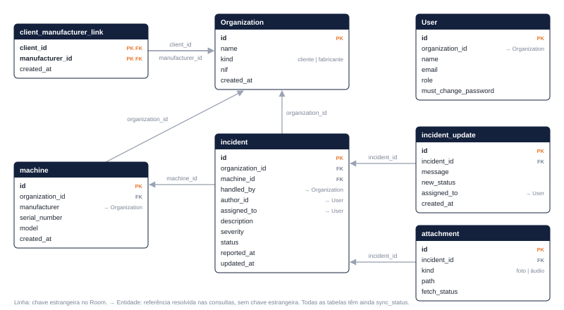<figcaption>Figura 1. Tabelas do Room (esquema na versão 2). As tabelas técnicas Auth e sync_state não estão representadas.</figcaption></figure>

### 5.2 O que cada perfil vê

Na variante demo, o telemóvel guarda os dados de todas as organizações, por isso as consultas ao Room aplicam as mesmas regras de visibilidade que o servidor:

| Perfil | Ocorrências | Máquinas |
|---|---|---|
| Cliente | as da sua organização | as da sua organização |
| Assistência e gestor do fabricante | as que o fabricante trata | as que fabricou |
| Técnico | as que reportou ou que lhe foram atribuídas | as que o fabricante fabricou |

O `Repository` guarda o utilizador com sessão iniciada num `StateFlow` (`signedIn`). Cada lista parte desse utilizador através de `whenSignedIn`, que usa `flatMapLatest`: quando o utilizador muda, a consulta anterior é cancelada e começa outra, e sem sessão a lista fica vazia. Do perfil sai um `Scope` com três valores, o cliente, o fabricante e o técnico (`User.scope`, em `data/model/User.kt`), e o Repository passa-os às consultas dos DAO: `observeVisibleWithMachine` para as ocorrências e `observeVisible` para as máquinas. Na cláusula `WHERE`, cada valor que não é `null` restringe a lista, por isso a mesma consulta serve todos os perfis.

Ligar as listas ao `StateFlow`, em vez de ler o utilizador uma única vez, também resolve o regresso da aplicação depois de o Android terminar o processo: os ecrãs são recriados antes de a sessão ser restaurada, e as listas preenchem-se assim que ela fica disponível.

## 6. Organização do código

```
app/src/main/java/com/example/fixtag/
├── api/              Retrofit: pedidos, respostas (DTO) e tokens
├── data/             Room, Repository, sincronização e dados de exemplo
│   └── model/        entidades e DAO
└── ui/
    ├── login/        LoginActivity e o seu ViewModel
    ├── main/         MainActivity e a navegação por separadores
    ├── fragments/    um fragmento por ecrã
    ├── viewmodels/   um ViewModel por ecrã
    ├── adapters/     adaptadores das listas
    └── dialogs/      seleção de máquina e de organização
```

A aplicação segue a arquitetura MVVM recomendada no guia de arquitetura do Android. O fragmento só trata da interface: observa o estado que o ViewModel expõe, num `StateFlow`, e passa-lhe as ações do utilizador, como tocar em guardar. Não valida dados nem acede à base de dados.

O ViewModel guarda o estado do ecrã, que sobrevive a rotações, e contém a lógica: valida os formulários, decide que erro mostrar e pede ao Repository para guardar. Os ViewModels dos formulários partilham uma classe base, `InputBaseViewModel`, com o estado do formulário (a editar, a guardar, guardado) e o canal das mensagens de erro. Recebem o Repository pelo construtor, através de fábricas como a `AppViewModelFactory`.

O `Repository` é o único que fala com o Room e com a API, e é ele que decide se uma operação fica no telemóvel ou passa pelo servidor, conforme a variante. É criado uma só vez, na classe `FixTag` (a `Application`), junto com a base de dados e o WorkManager. Assim, a interface, a lógica e o acesso aos dados ficam separados, como pede o enunciado: mudar a forma de guardar os dados não obriga a mexer nos ecrãs, e mudar um ecrã não obriga a mexer nos dados.

## 7. Validação e tratamento de erros

| Formulário | O que é validado |
|---|---|
| Ocorrência | máquina escolhida; descrição não vazia |
| Máquina | cliente escolhido; modelo não vazio; número de série não vazio e ainda não registado |
| Cliente | nome não vazio; NIF com 9 dígitos e dígito de controlo válido; NIF que não seja de um fabricante; nome e e-mail válidos do gestor; e-mail ainda sem conta |
| Conta | nome não vazio; e-mail válido e ainda sem conta; perfil escolhido |
| Alteração da palavra-passe | palavra-passe atual correta; a nova com pelo menos 8 caracteres e diferente da atual |

Os erros aparecem no próprio campo e o botão de guardar fica sempre ativo, por isso cada tentativa volta a validar. Os erros que não pertencem a nenhum campo, como a falta de ligação ao servidor, aparecem numa mensagem.

Os erros previsíveis não chegam à interface como exceções. Os pedidos à API correm em corrotinas, dentro de `try`/`catch`, e o Repository devolve um resultado tipado. Por exemplo, `registerClient` devolve um `Registration` (`Registered`, `Linked`, `NifIsAManufacturer`, `EmailTaken` ou `Failed`) e `changePassword` devolve um `PasswordChange`; o ViewModel converte cada caso no erro do campo certo ou numa mensagem. As mensagens que não pertencem a nenhum campo passam por um `Channel`, para aparecerem uma só vez e não se repetirem depois de rodar o ecrã.

Na sincronização, o `SyncWorker` trata as falhas de rede e do servidor pedindo ao WorkManager para tentar outra vez (secção 4.3), e um anexo cujo ficheiro já não existe é apagado, em vez de impedir o envio dos outros. As escritas que tocam em várias tabelas são transações, por isso uma falha a meio não deixa dados incompletos.

## 8. Interface

A interface conta com componentes Material 3, um tema de fácil visibilidade e com contornos de modo a que os elementos de principal interação sobressaiam.

### 8.1 Entrada

Na variante demo, escolhe-se o tipo de organização e depois um dos perfis de exemplo. Na variante full, entra-se com e-mail e palavra-passe, e quem ainda tem a palavra-passe temporária tem de a mudar antes de continuar.

<div class="shots">
<figure>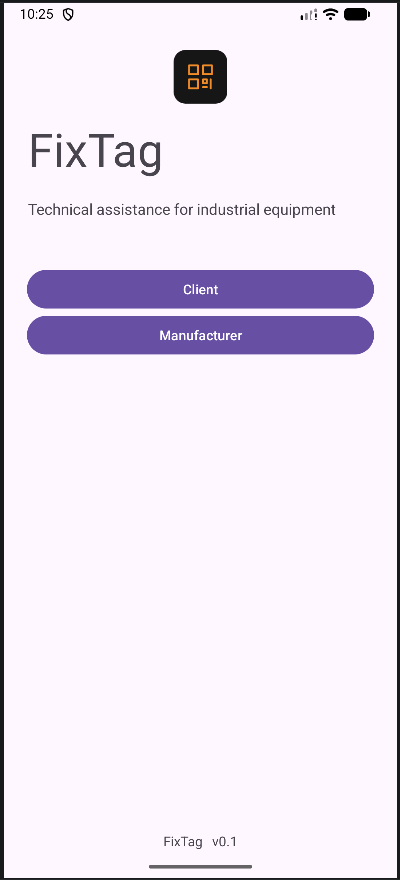<figcaption>Figura 2. Tipo de organização (demo)</figcaption></figure>
<figure>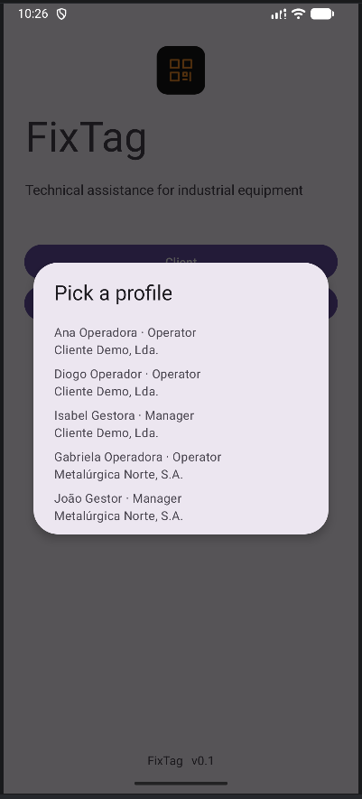<figcaption>Figura 3. Perfis de um cliente (demo)</figcaption></figure>
<figure>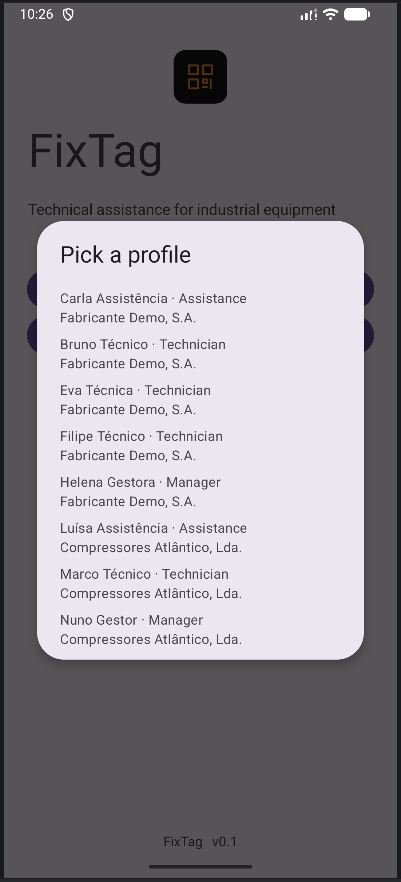<figcaption>Figura 4. Perfis de um fabricante (demo)</figcaption></figure>
<figure>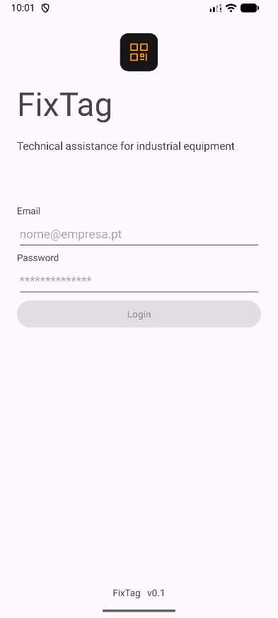<figcaption>Figura 5. Login (full)</figcaption></figure>
<figure>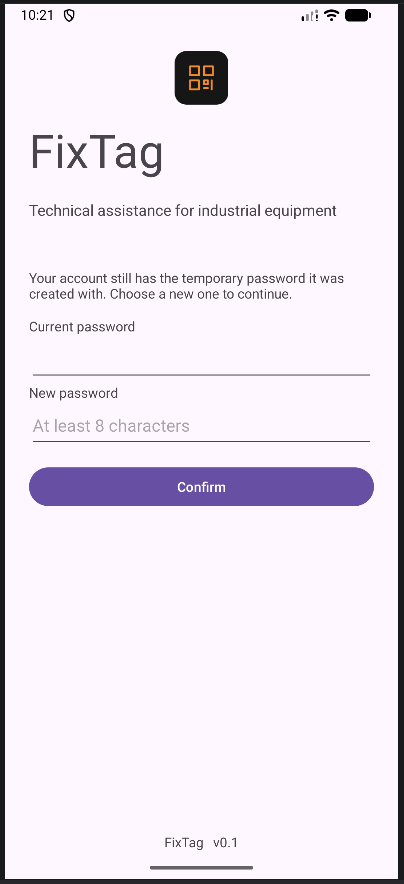<figcaption>Figura 6. Mudar a palavra-passe temporária (full)</figcaption></figure>
</div>

### 8.2 Ocorrências

Cada perfil vê apenas as ocorrências a que tem acesso (secção 5.2). Sem rede, a faixa no topo indica quantos registos faltam enviar. O mesmo formulário serve para criar e para editar uma ocorrência; a figura 10 mostra-o a editar, em modo escuro, que a aplicação segue a partir da definição do sistema.

<div class="shots">
<figure>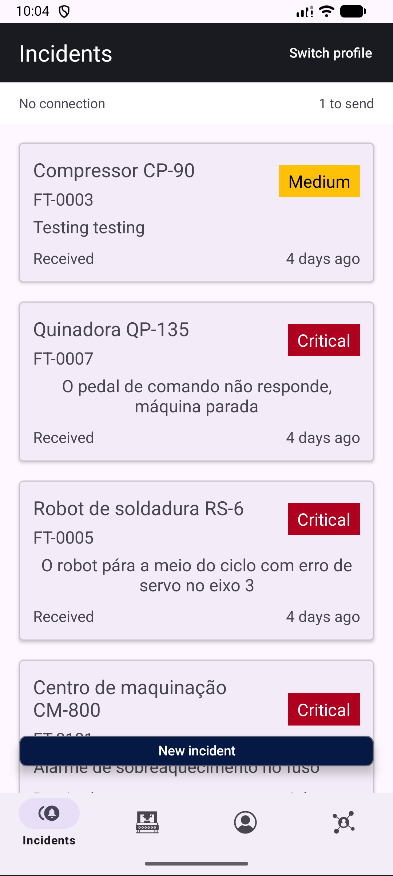<figcaption>Figura 7. Lista do gestor do fabricante</figcaption></figure>
<figure>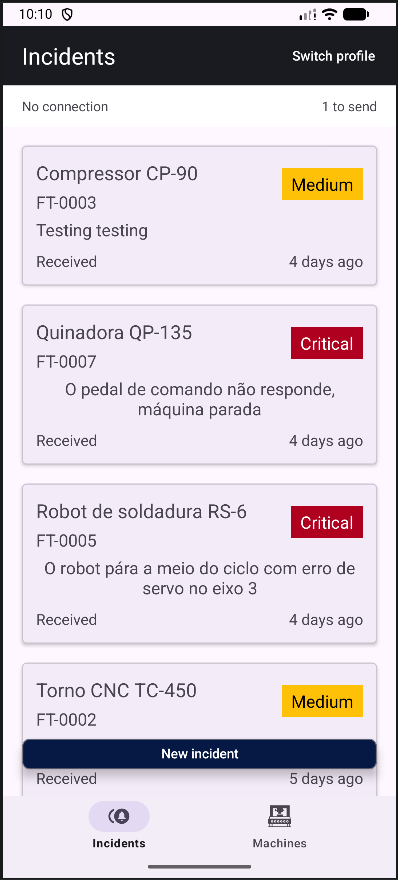<figcaption>Figura 8. Lista do operador do cliente</figcaption></figure>
<figure>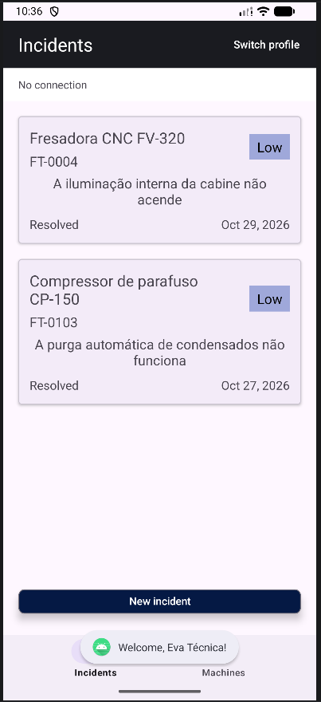<figcaption>Figura 9. Lista de um técnico: as que reportou ou que lhe foram atribuídas</figcaption></figure>
<figure>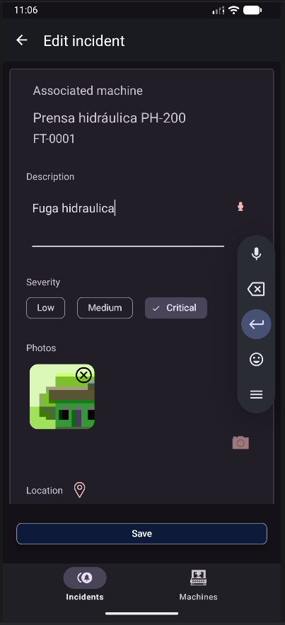<figcaption>Figura 10. Formulário da ocorrência, a editar (modo escuro)</figcaption></figure>
<figure>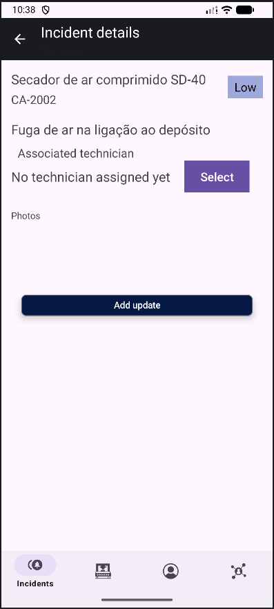<figcaption>Figura 11. Detalhe, ainda sem técnico</figcaption></figure>
<figure>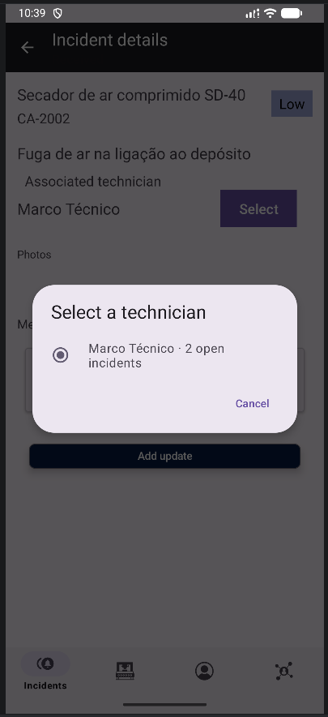<figcaption>Figura 12. Escolha do técnico, com as ocorrências abertas de cada um</figcaption></figure>
<figure>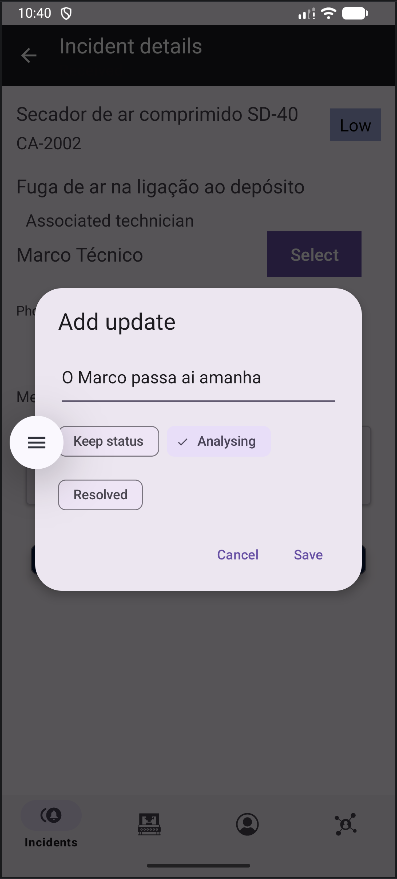<figcaption>Figura 13. Nova atualização, com mudança de estado</figcaption></figure>
<figure>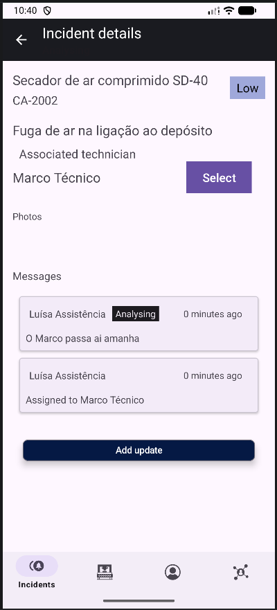<figcaption>Figura 14. Detalhe com o histórico</figcaption></figure>
</div>

### 8.3 Máquinas, contas e clientes

O gestor do fabricante regista máquinas, clientes e contas. O que ainda não foi enviado ao servidor pode ser eliminado, depois de uma confirmação.

<div class="shots">
<figure>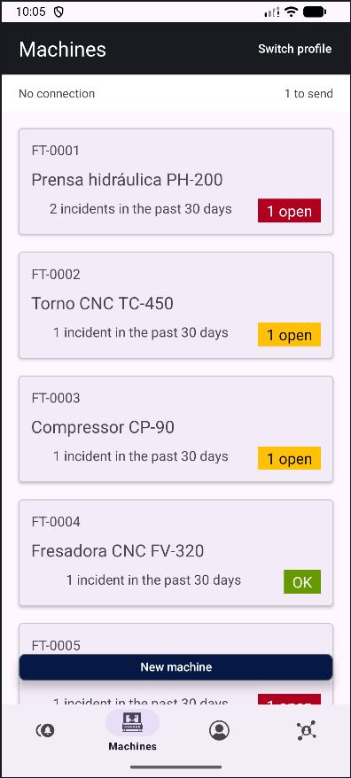<figcaption>Figura 15. Máquinas, vistas pelo gestor do fabricante</figcaption></figure>
<figure>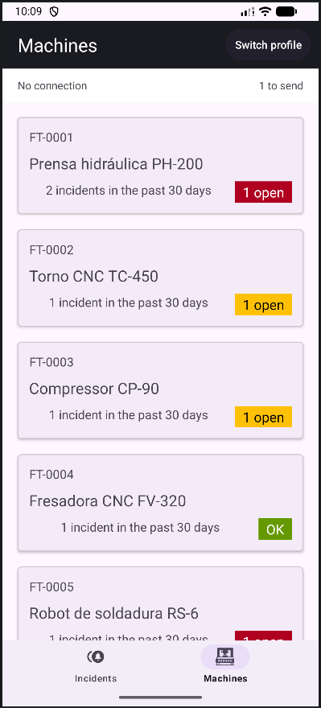<figcaption>Figura 16. Máquinas, vistas pelo operador do cliente</figcaption></figure>
<figure>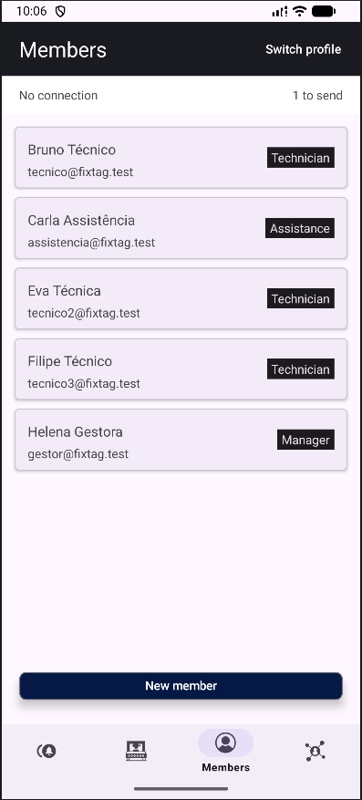<figcaption>Figura 17. Contas do fabricante</figcaption></figure>
<figure>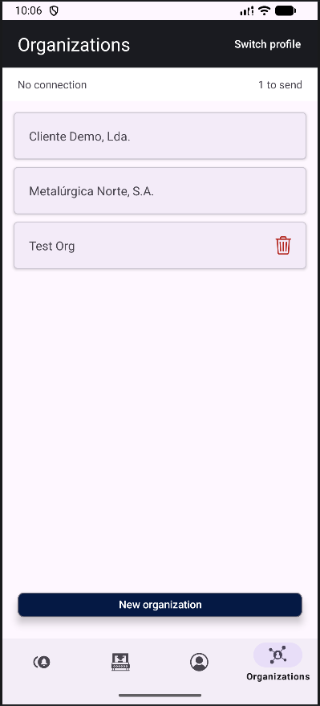<figcaption>Figura 18. Clientes do fabricante</figcaption></figure>
<figure>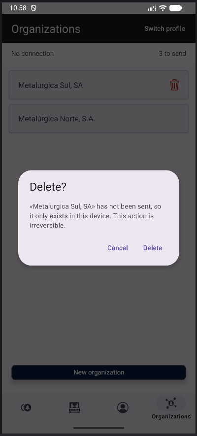<figcaption>Figura 19. Confirmação antes de eliminar</figcaption></figure>
<figure>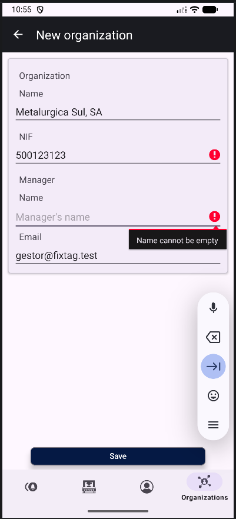<figcaption>Figura 20. Registo de cliente com erros de validação</figcaption></figure>
<figure>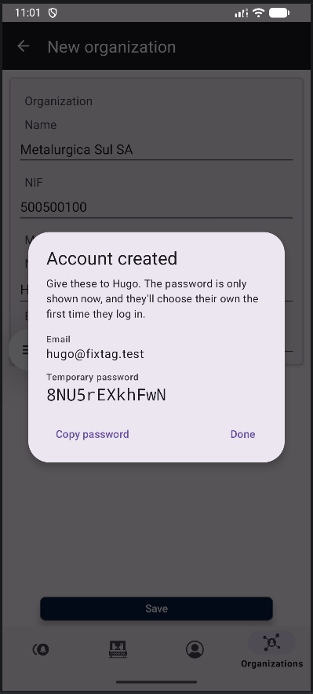<figcaption>Figura 21. Palavra-passe temporária da conta criada (full)</figcaption></figure>
</div>

## 9. Decisões de implementação

- **Offline-first, com o Room como fonte de verdade.** As pedreiras têm muitas vezes pouca ou nenhuma rede, e o operador tem de conseguir reportar a avaria nesse momento. A interface lê sempre do Room e nunca diretamente da API, por isso o que se escreve fica guardado logo e os mesmos ecrãs funcionam com e sem ligação (requisitos 7 e 12).
- **Duas variantes, `demo` e `full`, com `BuildConfig.OFFLINE_DEMO`.** A variante demo cumpre o enunciado tal como está, com tudo local e sem servidor nem contas; a full é a base das entregas seguintes. Partilham todo o código, e a constante só muda o que tem de mudar: o ecrã de entrada, o registo de clientes e de contas, e se há sincronização.
- **Identificadores UUID gerados no dispositivo.** Um registo criado offline já tem o identificador que terá no servidor. Com identificadores gerados pelo servidor, seria preciso um identificador provisório, e cada anexo ou atualização que apontasse para ele teria de ser corrigido depois do envio. Com UUID, enviar o mesmo registo duas vezes também não cria um duplicado.
- **Regras de visibilidade nas consultas do Room.** Na variante demo não há servidor a filtrar o que cada perfil vê, e o telemóvel guarda os dados de todas as organizações. Filtrar nas consultas, e não em cada ecrã, garante que nenhum ecrã mostra o que o perfil não devia ver, e a demonstração mostra o mesmo que o servidor enviaria.
- **Sincronização em segundo plano com o WorkManager.** O envio tem de acontecer mesmo que o utilizador feche a aplicação logo depois de reportar, e só quando há rede. O WorkManager guarda o pedido, espera pela rede, resiste ao reinício do dispositivo e volta a tentar quando falha.
- **Contas e clientes criados só com ligação ao servidor.** Só o servidor conhece todos os NIF e e-mails já registados, por isso só ele pode garantir que não há duplicados. É também ele que gera a palavra-passe temporária, que aparece uma única vez, no diálogo que se segue ao registo. Criar contas offline obrigaria a guardar palavras-passe no telemóvel até haver rede.
- **Migração destrutiva na versão 2.** Nenhum telemóvel tem ainda dados que não se possam recriar (secção 4.2), e escrever migrações enquanto o esquema ainda está a mudar seria trabalho deitado fora.

## 10. Funcionalidades adicionais

| Funcionalidade | Onde |
|---|---|
| Sincronização com a API (variante full) | `data/SyncWorker.kt`, `data/Repository.kt` |
| Fotos e gravações de áudio nas ocorrências | `NewIncidentFragment`, `files/attachments/` |
| Localização GPS | Google Play Services Location, em `NewIncidentFragment` |
| Vários fabricantes e clientes, com perfis diferentes | secção 5.2 |
| Duas línguas, português e inglês | `values-pt/`, `values/` |
| Modo claro e escuro, conforme o sistema | `values-night/`, figura 10 |
| Testes automatizados | secção 11 |

A sincronização é a funcionalidade adicional com mais peso: permite que várias pessoas, em telemóveis diferentes, trabalhem nas mesmas ocorrências, sem que a aplicação deixe de funcionar sem rede. As fotos, o áudio e a localização dão ao fabricante o contexto que hoje se perde em mensagens soltas. Os testes automatizados verificam os dados de exemplo e o que cada perfil pode ver.

## 11. Testes

| Teste | Tipo | O que verifica |
|---|---|---|
| `DemoSeedRulesTest` | unitário (JVM) | que os dados de exemplo cumprem as regras do domínio |
| `DatabaseTest` | instrumentado | escrever e ler organizações, máquinas e utilizadores nos DAO |
| `DemoSeedTest` | instrumentado | que cada perfil vê o que o servidor lhe enviaria |

Os 6 testes unitários passam: os 5 de `DemoSeedRulesTest` e o exemplo criado pelo Android Studio (`gradlew testDemoDebugUnitTest`, a 7/11/2026). Os testes instrumentados (`DatabaseTest` e `DemoSeedTest`) passam, com a sua execução confirmada em Medium Phone API 37.0.

## 12. Dificuldades

- **Passar para vários fabricantes e clientes.** Até 27/10 havia um só de cada. Com vários, cada consulta passou a depender do perfil (secção 5.2), e os dados de exemplo tiveram de cobrir cada caso, como um cliente com máquinas de dois fabricantes ou um técnico que só vê o que lhe foi atribuído. Os testes `DemoSeedRulesTest` e `DemoSeedTest` verificam isso.
- **Identificadores em texto e em binário.** Algumas colunas, como o autor de uma ocorrência e o técnico atribuído, guardam o UUID como texto, tal como chega da API, mas um parâmetro `Uuid` de uma consulta é passado como BLOB. O SQLite nunca considera iguais um texto e um BLOB, por isso a consulta não devolvia nada, sem dar erro. A solução foi passar o técnico à consulta como texto (`scope.technician?.toString()`).
- **O ecrã de login em branco.** Ao juntar o login e a alteração da palavra-passe num `NavHostFragment`, o fragmento de login ficou sem layout, e o `onViewCreated` nunca corria. Além disso, entrar não levava ao ecrã seguinte. A solução foi dar o layout ao fragmento (`Fragment(R.layout.fragment_login)`) e decidir a navegação num único sítio, o `LoginViewModel`.
- **Erros de validação que não voltavam a aparecer.** Um `StateFlow` não emite um valor igual ao que já tem, por isso tocar outra vez em guardar com o mesmo erro não mostrava nada. O estado dos formulários passou a ser comparado por identidade (`FormState`, em `InputBaseViewModel.kt`).
- **O Android terminar o processo.** Quando a aplicação volta depois de o sistema a terminar, os ecrãs são recriados antes de a sessão ser restaurada, e as listas ficavam vazias. Passaram a depender do `StateFlow` com o utilizador (secção 5.2).

Algumas destas dificuldades foram resolvidas com a ajuda das revisões feitas com IA, indicadas na secção 13.

## 13. Utilização de IA e de código externo

### 13.1 Código gerado com IA

Ferramenta: Claude (Anthropic), através do Claude Code.

| Parte | O que foi gerado | Ficheiros principais |
|---|---|---|
| Servidor (`backend/`) | todo o código, os testes e a documentação da API, como declarado ao docente | `backend/` |
| Mudança para `multi-tenant` | snippets sobre a mudança para arquitetura `multi-tenant` a nível de dados, filtragem de dados por perfil, de modo a espelhar o que acontece no `backend` | `Helpers.kt`, `NewMembersFragment`, `NewOrganizationsFragment`, `Repository`, `ApiClient` |
| Este relatório | o modelo (estrutura, formatação, script de exportação e o diagrama da figura 1)  | `docs/report/` |

Ao longo do último ano e meio, quer a nível pessoal que a nível profissional tenho vindo a olhar para este tipo de ferramentas (IA), como muito mais do que um mero chatbot. Por vezes aplico uma dinâmica de colega de equipa como se fosse alguém com quem estivesse a programar em par, por vezes recorro de modo a descobrir onde está o bug, outras vezes dá jeito simplesmente poder trocar ideias de forma objetiva.

Neste caso aplicam-se todas as opções, mas de maneira diferente daquilo que tem sido o meu uso normal deste tipo de ferramentas. O objetivo traçado desde início tinha sido: o Claude ficava responsável pelo desenvolvimento da API porque esta tecnicamente fica fora do âmbito da disciplina, a tecnologia escolhida para a mesma foi de acordo com a minha experiência dado que, entre projetos pessoais e profissionais, já tenho vários anos de experiência com Rust e algumas das bibliotecas escolhidas nesse lado.

Do lado da aplicação, escolhi propositadamente o Kotlin porque a minha experiência passada com Android tinha sido exclusivamente Java e React/Native, como nem sempre consegui encontrar explicações sobre o que procurava em motores de busca, acabei por recorrer ao Claude para me ajudar a perceber onde estava o problema em questão, ou para conseguir chegar ao objetivo em mente mais rapidamente.

Todo o código gerado que tenha sido usado foi testado e estudado de acordo com o objetivo do trabalho de modo a ser compreendido.

### 13.2 Bibliotecas externas

| Biblioteca | Para quê |
|---|---|
| Room | base de dados local |
| DataStore (Preferences) | sessão da variante demo |
| WorkManager | sincronização em segundo plano |
| Navigation | navegação entre fragmentos |
| Material Components | interface (Material 3) |
| Retrofit, OkHttp e Gson | pedidos à API e conversão de JSON |
| Coil | carregar as fotos dos anexos |
| Play Services Location | localização das ocorrências |
| Kotlin Coroutines | operações assíncronas e `Flow` |

## 14. Conclusão

Esta entrega cumpre os requisitos obrigatórios e o ciclo completo de gestão das ocorrências, com o Room como armazenamento principal e sem depender de rede. Em relação à apresentação do trabalho de 27/10 e ao que foi demonstrado, junta vários fabricantes e clientes com perfis diferentes, a atribuição de técnicos, a edição de ocorrências, a criação de contas com palavra-passe temporária e a variante full, que sincroniza com o servidor.

Ficaram de fora as migrações explícitas do esquema (secção 4.2), a eliminação de registos que já estão no servidor, que precisa de uma regra no servidor sobre quem o pode fazer, e a opção de sincronizar só por Wi-Fi.

A entrega do mini-projeto coletivo (de forma individual) alarga novamento o âmbito, desta vez aos cidadãos, que poderão reportar problemas em espaços públicos, com novos perfis e alterações ao modelo de dados, e acrescenta um mapa das ocorrências em curso, filtrado por perfil, a partir da localização que cada ocorrência já guarda.

## Referências

- Android Developers. *Save data in a local database using Room*. <https://developer.android.com/training/data-storage/room>
- Android Developers. *DataStore*. <https://developer.android.com/topic/libraries/architecture/datastore>
- Android Developers. *Task scheduling with WorkManager*. <https://developer.android.com/develop/background-work/background-tasks/persistent>
- FixTag. *Protocolo experimental: persistência local e funcionamento offline*, 27/10/2026 (`docs/protocolo-experimental.pdf`).
- Android Developers. *Guide to app architecture*. <https://developer.android.com/topic/architecture>
- Android Developers. *Kotlin flows on Android*. <https://developer.android.com/kotlin/flow>
- Android Developers. *Navigation*. <https://developer.android.com/guide/navigation>
- Square. *Retrofit*. <https://square.github.io/retrofit/>
